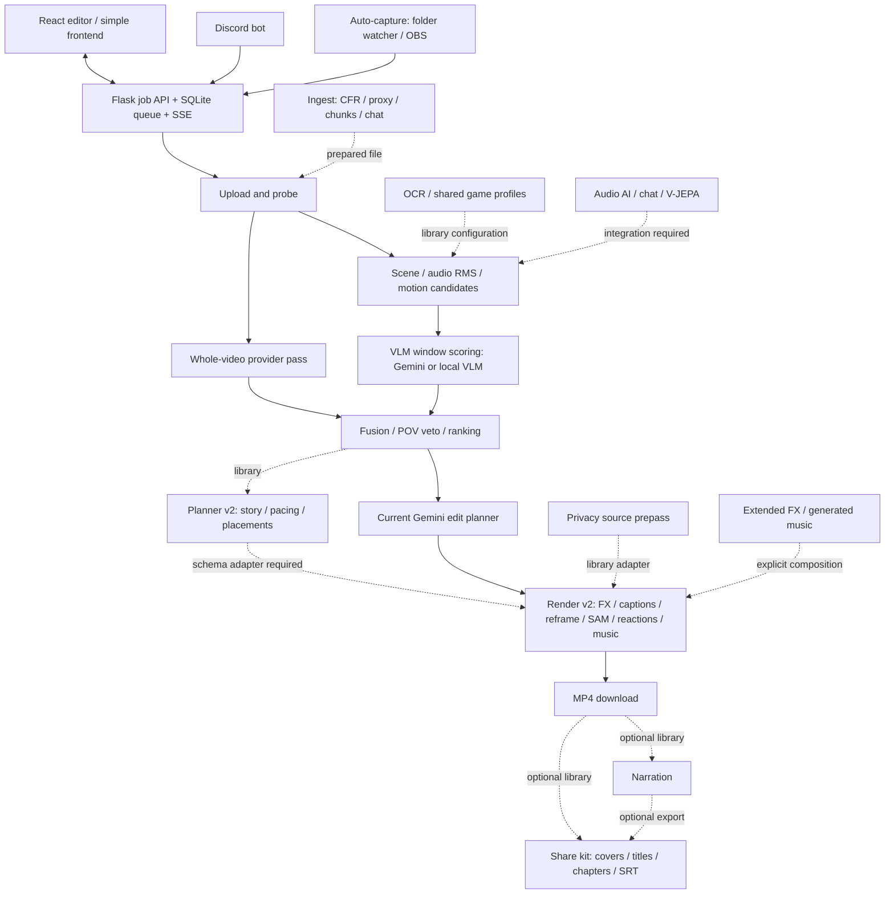

# AI Gameplay Clip Editor — Extension

Turn gameplay into a highlight montage or playful fail reel. Upload a recording, analyze candidate moments, review and trim clips, then render a landscape, vertical, or square MP4. Flask runs a durable job queue; React provides the review editor; Gemini or a local vision model evaluates footage; FFmpeg renders the edit.

This describes the DOC-01 Extension snapshot. Some sprint modules are usable libraries rather than app features. Start with the [quickstart and configuration reference](docs/quickstart.md); see [architecture](docs/architecture.md) for integration boundaries.

| Before Extension | Available in this snapshot |
| --- | --- |
| Whole-video Gemini prompt | Scene/audio/motion candidates, window VLM scoring, whole-video pass, fusion and deduplication |
| Gemini-only analysis | Gemini or local VLM analysis; local analysis still uses Gemini for automatic planning |
| In-memory blocking workflow | SQLite checkpoints, worker queue, resume, cancellation and replayable SSE; legacy routes retained |
| Basic clip list | React review timeline with trim, keep/drop, reorder and metadata editing |
| Source-sized montage with VFX/SFX | Render v2 presets, captions, reframing, transitions and supplied music; optional reactions and SAM |
| One edit-planning prompt | Existing automatic Gemini planner plus standalone deterministic planner v2, requiring a renderer adapter |
| Manual uploads | Upload API plus separate Discord bot and desktop folder/OBS capture companion |
| No preparation/export toolkit | Standalone VOD/chat ingest, audio AI, profiles, V-JEPA scaffold, privacy, FX, narration, music, multi-POV and share-kit libraries |



Solid arrows describe the app path; dashed arrows require explicit library use or integration. Privacy must process the source before cuts and reframing. The app does not automatically generate narration or a share kit.

| Supported game | Shared profile ID | Scope |
| --- | --- | --- |
| Valorant | `valorant` | HUD regions, event vocabulary, prompt fragment |
| Overwatch 2 | `overwatch2` | HUD regions, event vocabulary, prompt fragment |
| Deadlock | `deadlock` | HUD regions, event vocabulary, prompt fragment |
| League of Legends | `league_of_legends` | HUD regions, event vocabulary, prompt fragment |
| Other/uncertain | `generic` | Generic fallback |

These are configurable heuristics, not validated event classifiers. The HTTP API takes game context through `prompt`, not `game` or `profile`. Shared profiles are not wired into the pipeline detector; its `auto` OCR profile means generic regions. V-JEPA uses `league` as its training ID. See [profiles](docs/game_profiles.md), [signals](docs/signals.md), and [V-JEPA](docs/vjepa.md).

## Start locally

Use Python 3.10+ (Docker uses 3.12), FFmpeg/ffprobe with libx264, AAC, drawtext and libass, and Node 22 for the optional React build. Bash, from a new checkout:

```bash
git clone --branch Extension https://github.com/irajmoradi/hacklanta_2026_LIM.git
cd hacklanta_2026_LIM
python -m venv .venv
source .venv/bin/activate
python -m pip install -r full_app/requirements.txt
# Set GEMINI_API_KEY in this process using your secret manager.
cd full_app
python app.py
```

Open http://localhost:8000. Analysis/planning uses paid requests; uploading alone does not. The [quickstart](docs/quickstart.md) includes PowerShell, React, Vertex express, local VLM and a key-free render test.

## Start with Docker

From the repository root, with Docker Compose and runtime `GEMINI_API_KEY` configured:

```bash
docker compose up --build -d
docker compose logs -f app
```

Open http://localhost:8000; the image serves React. `docker compose down` stops it and retains the named workspace volume. Compose forwards only the provider variables listed in [configuration](docs/quickstart.md#configuration); other settings need explicit container environment overrides and asset mounts. The service has no authentication or tenant isolation: use a trusted local/private network. Port 8000 binds on all interfaces.

## Cost and research

Default analysis scores each proposed window, then makes a whole-video pass; planning is another request. Chunks, splits and retries can multiply calls. Reduce requests with `window_scoring: false`, `splits: 1`, and `generate_thumbnails: false`; these are not a hard billing cap. Local analysis has compute costs and still calls Gemini for automatic planning. Explicit edit plans skip both AI stages. Narration, remote SAM, generated images and Modal can add charges. No fixed dollar estimate is promised; provider usage logs can estimate cost when caller-supplied token rates are configured.

The design follows the proposal → window scoring → fusion pattern in [research notes](docs/RESEARCH.md): cheap temporal signals propose moments, a VLM checks context and viewpoint, and validation constrains timestamps. Research references are background, not evidence of this repository's accuracy. [Evaluation](docs/eval.md), the [offline demo](docs/e2e.md), and [performance notes](docs/performance.md) describe synthetic checks and their limits.

## Development and credits

Use an `ext/<TASK>` worktree; the integrator merges into `Extension`. Follow [AGENTS.md](AGENTS.md). From the worktree root, on the configured Linux runner:

```bash
bash tools/remote_run.sh "cd full_app && python -m pytest -q -m 'not live'"
bash tools/remote_run.sh "cd full_app/production_frontend && npm ci && npm test && npm run build"
bash tools/remote_run.sh "python -m pytest -q docs/README_ASSETS/test_documentation.py"
```

Ordinary tests mock paid providers and generate synthetic media. Live tests require explicit opt-in and at most three Gemini calls per task run. Keep credentials, recordings, weights and outputs out of git.

Built for HackLanta 2026 by the repository contributors, using Flask, React/Vite/Tailwind, FFmpeg, Google Gen AI SDK, OpenCV, NumPy, Pillow and optional model/tool projects. No top-level project `LICENSE` is present in this snapshot; repository visibility does not establish a redistribution license.

Bundled meme SFX referenced by `full_app/models/effects.py` are third-party assets; inclusion does not establish redistribution or monetization permission. Replace them with owned/licensed audio where necessary. Reaction packs require rights and consent for images, video and voices. Narration uses a stock voice unless an explicitly consented voice is configured. Music manifests record license/attribution metadata; the app cannot verify those claims.

Model code and weights have separate, checkpoint-specific terms. Check the exact SAM 2/2.1, V-JEPA 2, Whisper, YAMNet, or locally served Qwen/InternVL/Molmo checkpoint license before provisioning or redistribution; no blanket model license is asserted here. The base install bundles no such weights. Hosted Gemini/ElevenLabs usage follows provider terms. See [SAM](docs/sam.md), [providers](docs/video_models.md), [audio AI](docs/audio_ai.md), [music](docs/music.md), [reactions](docs/reactions.md), and [narration](docs/narration.md) for adapters.
