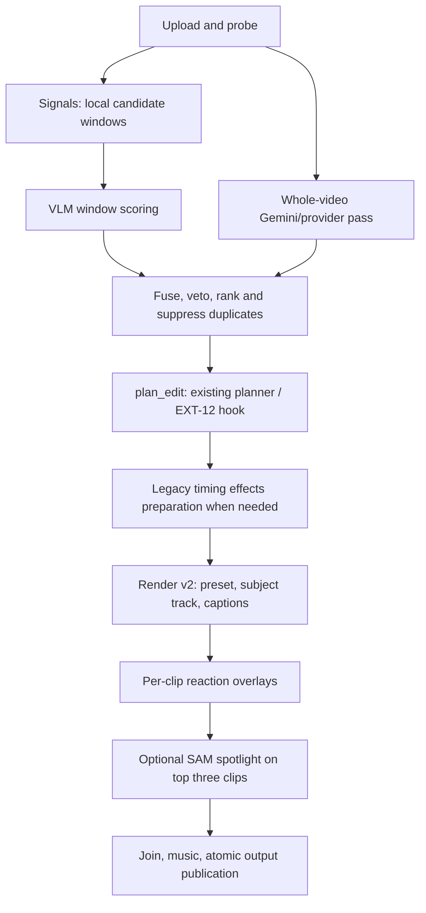

# Integrated Extension pipeline (INT-01)

The job queue calls `pipeline.Pipeline`; `server.pipeline` is a compatibility
import. Upload probes media before admission. Analysis re-probes the source.
Legacy HTTP routes still block on the same durable queue.



The implementation runs window scoring then the whole-video pass sequentially.
Both use the selected video provider. Local VLM analysis retains Gemini as the
edit planner until EXT-12. Explicit edit plans skip analysis and planning.

## Options and defaults

These are additions/updates to the options in `docs/api.md`; that document's
old placeholder import contracts are superseded here. Flags require JSON booleans.

| Option | Default | Effect |
| --- | --- | --- |
| `use_signals` | `true` | EXT-01 `detect_candidates`; dataclasses normalized to JSON |
| `window_scoring` | `true` | EXT-02 `score_windows` on signal candidates |
| `provider` | `gemini` | Gemini or `local` / `local_vlm`; custom factory supported |
| `captions` | `false` | Enable v2 words and optional local transcription |
| `reactions` | on when `REACTION_PACK` is configured | One seeded selector per montage |
| `sam_reframe` | `false` | Convert absolute `sam.subject_track` samples to clip-local v2 points |
| `sam` | `false` | SAM spotlight freeze on the three highest-scoring rendered segments |
| `preset` | `landscape` | Also `vertical` and `square`, at 1080 resolution by default |
| `generate_thumbnails` | `false` (legacy route: `true`) | Retained legacy thumbnail generation |

`mode`, `style`, `prompt`, `splits`, and `max_duration` retain the existing
analysis/planner meanings. Changing window scoring invalidates analysis and all
downstream checkpoints. Render flags invalidate only rendering. Explicit v2
plans retain their resolution, transitions, captions, music and title settings;
an explicit captions flag overrides the plan's enabled setting.

Set `GEMINI_API_KEY` (or supply `X-API-Key`). Local analysis reads `LOCAL_VLM_URL`,
`LOCAL_VLM_MODEL` and optional `LOCAL_VLM_API_KEY`; its planner still needs the
Gemini key. `REACTION_PACK` points to an existing folder containing `pack.json`.
SAM uses its existing `SAM_BACKEND` configuration, defaulting to local CV masks
without weights. Captions require a cached faster-whisper model unless word
timestamps are supplied in a v2 plan. Nothing downloads models automatically.

## Fusion and timelines

Signal-only scores are clamped to [0, 1]. Scored candidates use
`0.35 * signal + 0.65 * hype / 10`. Unknown/dead viewpoints veto overlapping
candidates from **both** sources, so the whole-video pass cannot restore a
spectating window. Alive neutral windows are omitted. Whole-video candidates
default to score 0.5. Rank descending; suppress overlaps covering at least half
the shorter candidate, retaining the higher-ranked complete beat and provenance.
IDs are regenerated after merging. `candidates`, `window_scores`, and ranked
`clips` are JSON-serializable snapshot fields.

Legacy speed/effect/transition payloads are baked with the existing renderer
before v2 processing; the resulting segment durations are probed to reset their
timelines. SAM tracks then follow that prepared media. Reactions operate on
rendered clip-local time. Spotlight adds 0.6 seconds of freeze and the renderer
uses the resulting duration when joining clips. It can extend planned duration.
For prepared legacy segments, use automatic captions; supplied original word
timestamps are not carried through time-changing effects.

## Fallbacks and progress

Missing optional imports/functions produce snapshot warnings. Missing signals
uses whole-video analysis; a provider without window scoring retains raw signal
candidates. Missing reactions or SAM skips that feature. Missing transcription
dependencies/model cache keeps supplied words and renders without automatic
captions. Unknown custom providers fall back to Gemini with a warning.
Installed callables that fail are not silently ignored: the queue records a
sanitized stage error and retains completed checkpoints for retry.

Missing render v2 uses the legacy renderer. Legacy source-sized renders and
thumbnail requests also retain their compatibility render path, without v2-only
features. New API requests use v2 by default; `ENABLE_RENDER_HOOK` is obsolete.

Every substage emits persisted SSE progress with `pipeline_stage` and `timings`
(seconds), and logs elapsed time without provider exception details or keys.
The existing coarse `stage`/`progress` and checkpoint semantics remain intact.
Partial results are not checkpointed. Cancellation during a substage remains
cooperative at the enclosing analyze/plan/render boundary and cannot be
overwritten by progress reports. Scratch files are removed on success/failure.

## Try and verify

Run `cd full_app && python app.py`. Upload with `POST /api/jobs`, then POST `{}`
to `/api/jobs/<id>/analyze`. After planning, POST
`{"preset":"vertical","captions":true,"sam_reframe":true,"sam":true}` to
`/api/jobs/<id>/render`. Observe `/events` and download `/download` when done.
Set a reaction pack in the server environment to enable overlays by default.

Offline regression suite (synthetic ffmpeg media and mocked providers):

```bash
tools/remote_run.sh "cd full_app && python -m pytest -q -m 'not live'"
```

No live API calls are required for these tests. Window scoring may make one paid
request per candidate in production, in addition to the whole-video pass and
planner; disable it explicitly when evaluating a limited live-call budget.

INT-01 verification on the Linux runner:

| Command passed to `tools/remote_run.sh` | Result / exit |
| --- | --- |
| `cd full_app && python -m pytest -q -m 'not live'` (baseline) | 160 passed, 4 failed, 4 skipped, 1 deselected / 1 |
| `cd full_app && python -m pytest -q tests/test_pipeline.py tests/test_jobs.py eval/test_app_smoke.py` | 43 passed / 0 |
| `cd full_app && python -m pytest -q -m 'not live'` (speed regression added) | 183 passed, 1 failed, 4 skipped, 1 deselected / 1 |
| `cd full_app && python -m pytest -q -m 'not live'` (final) | 186 passed, 4 skipped, 1 deselected / 0 |

The speed regression exposed output-side FFmpeg trimming that truncated slowed
clips. Input-side trimming fixes it. Zero live provider calls were made.
