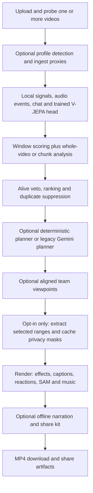

# Integrated Extension pipeline

The durable Flask queue calls `pipeline.Pipeline`. All options below are accepted
by the analyze, plan and render JSON endpoints described in `docs/api.md`.
This document supersedes that document's old optional-module import table.



## Flags and defaults

Flags must be JSON booleans. Unknown fields are rejected.

| Option | Default | Integration |
| --- | --- | --- |
| `profiles` | false | Local game detection; per-game OCR regions, alive/dead rules and prompt fragments |
| `game` | auto | Selecting game enables profiles: auto, generic, valorant, overwatch2, deadlock, league_of_legends |
| `use_signals` | true | Scene, motion, audio-energy and optionally profile OCR candidates |
| `window_scoring` | true | Provider verifies local candidates; false retains local evidence |
| `audio_ai` | false | Offline audio event candidates enter the same scoring/veto/ranking path |
| `ingest` | false | Job-owned normalized video, low-resolution analysis proxy and overlapping 900-second chunks; timestamps offset back to source |
| `chat` | absent | With ingest: numerical replay bins, described below |
| `vjepa` | false | Contributes only when `VJEPA_HEAD` names an existing trained head; missing extras/head contribute no scores |
| `planner` | false | Deterministic narrative planning; unavailable, incompatible or empty plans fall back to the existing Gemini planner |
| `fx` | false | The effect catalog selects timed zoom punches in deterministic plans; renderer composes validated timed registry requests |
| `privacy` | **false** | Blur selected source ranges in profile kill-feed, chat and party/voice regions before effects or framing; cache each range |
| `privacy_options` | defaults | Privacy payload: game, OCR backend, own-name preservation, webcam, regions and manual timed boxes |
| `multipov` | false | Align repeated multipart video uploads by audio, rank viewpoints using local evidence, compose selected primary-timeline intervals |
| `team_mode` | best | best, split or pip; ambiguous synchronization warns and retains primary POV |
| `music` | false | Generate an offline energetic/chill bed when the plan has no user-supplied music; duck under gameplay audio |
| `narration` | false | Offline script, cached voiceover or optional espeak/espeak-ng computer voice; no automatic paid calls |
| `social` | false | Offline share kit after rendering: video, metadata, chapters and thumbnails |
| `perf` | true | Encoder probing, bounded parallel clips, combined effects/SFX graph, SFX cache and compatible cut-only stream-copy joins |
| `captions` | false | Supplied word times or optional cached local transcription |
| `reactions` | true when REACTION_PACK exists | One seeded reaction selector per montage |
| `sam_reframe`, `sam` | false | Subject tracking and duration-preserving key-moment spotlight; missing SAM warns and skips spotlight |
| `preset` | landscape | landscape, vertical or square; API defaults to 1080 short-side resolution |
| `generate_thumbnails` | false | Legacy route retains true; may make paid thumbnail requests |

All previously supported mode, style, prompt, splits, max_duration and explicit
edit_plan inputs remain available. An explicit plan skips provider calls.
Optional integrations are lazy imports. Missing imports produce snapshot warnings;
installed render failures remain sanitized stage errors, not silently successful
jobs. Privacy OCR failure uses the module's conservative whole-region fallback.
For unknown games, privacy uses common HUD regions instead of guessing a game.
The user must review privacy output: OCR and region coverage are not guarantees.

Analysis flags invalidate analysis and downstream checkpoints. Planner/fx/style
changes invalidate planning and rendering. Other render flags invalidate only
rendering. Sources, proxies and internal filesystem paths are excluded from public
snapshots. Evidence and stage timings are JSON serializable and survive restart.

## Evidence, timing and rendering

Analysis adds audio events, numerical chat spikes and trained-head V-JEPA scores to
local candidates before provider verification. At most 30 strongest candidates are
scored. A non-alive or unknown viewpoint veto suppresses overlapping candidates
from both local and whole-video analysis. Alive neutral windows are omitted.
Ranking uses 0.35 * local score + 0.65 * hype / 10 for verified windows, followed by
nonmaximum suppression at half the shorter interval. Unscored local scores are
normalized monotonically as `0.5 + atan(raw_score) / pi` to (0, 1); provenance is recorded as `atan_signal`. The UI converts unit scores to percent. Whole-video results retain their score or default to 0.5.

Profiles contribute both the whole-video prompt and the provider's window prompt.
Ingest changes analysis media only; rendering retains original-quality media.
Chunk results are offset before fusion, and cached chunks are never deleted as
legacy split scratch files. `splits` is superseded when ingest supplies chunks.

The planner v2 output and renderer v2 input meet at
`planner.adapter.to_render_plan` (adapter version 1). Shared style/aspect names
live in `render.contracts`. The adapter validates the native version, rejects
empty plans, and subtracts each clip's output start from all placements. Speed
is applied once by the renderer; captions, reactions, effects, transitions and
SFX already use output seconds and are not divided by speed again. Native plans
remain available in `planner_plan`. Music mood/energy are intent, not an asset;
licensed/generated music must still be supplied separately.

Legacy preparation retains titles and retimes words, subject tracks and timed FX
by the measured encoded/source duration ratio, including unchanged segments in
a mixed plan. Native v2 plans retain top-level music, cards, fps and transitions.
SAM spotlight freezes can extend the planned duration.

React sends current caption/reaction/SAM flags and style at export. Editable
clip text is a title (`title`), not a transcript. Planning settings are persisted
separately; a changed style submits no stale explicit plan, allowing the
queue to replan from saved reviewed clips. Provider credentials must be configured
on the backend for the React UI; it has no key-entry control.

`services.provider_config` owns provider IDs and secret-free configuration
reporting. `gemini` uses GEMINI_API_KEY by default; set
GOOGLE_GENAI_USE_VERTEXAI=true and GOOGLE_API_KEY for Vertex express. An explicit
request key overrides the environment key in the selected mode. `local` and
`local_vlm` are hybrid: local analysis with Gemini planning unless `planner=true`.
Unknown provider IDs raise without constructing a paid client.

Scope limitation: `server/api.py` still needs to use `configuration()` for
`/api/info`, and `server/validation.py` needs `validate_provider()` for synchronous
HTTP rejection. Those files belong to the server worker. Pipeline rejection is
already enforced; the old info endpoint can still report a GOOGLE-only setup as
unconfigured. The HTTP plan-admission/security work is likewise separate.

`perf:false` or `LIM_PERF=0` selects the comparison renderer. Source-time trimming
is now the perf default, matching the corrected legacy renderer. Explicit
`Clip(timing="legacy")` remains available to toolkit callers. Encoder selection
probes actual hardware operation and retries CPU after hardware encode failure.
VAAPI graphs currently use CPU in v2 because ASS/RGB filters require host frames.
Parallel work preserves segment order; reaction/SAM callbacks remain sequential
because their selectors and progress records are stateful. Supplied captions,
VFX and SFX share a clip encode. Automatic transcription needs a rendered audio
pass first. SFX cache entries live in disposable render scratch; they are shared
between clips in the same render. Privacy and team preprocessing are separate
passes, so the speedup depends on enabled features. Legacy source-size and
thumbnail routes retain their compatibility renderer and its existing limits;
use the new job render endpoint for v2 framing, music and timed FX.

Narration does not initiate network synthesis; missing cached voiceovers leave
script-only output and warnings. Generated music beds are at most 600 seconds and
loop for longer montages. An existing plan music track always wins. Share-kit
creation receives the final montage and never an unsanitized source thumbnail.
Share artifacts live within the job directory and are removed by job deletion.
V-JEPA requires the optional dependencies and encoder weights corresponding to
the trained head; model loading follows that module's configuration.

## Try it

Start `cd full_app && python app.py`. POST a multipart `video` to `/api/jobs`.
Repeat that field (up to eight files) for a team job. Upload filenames are not
used as paths or player labels. Then POST to `/api/jobs/<id>/analyze`:

```json
{"profiles":true,"game":"auto","audio_ai":true,"ingest":true,"planner":true,"fx":true,"max_duration":30}
```

POST to `/api/jobs/<id>/render`:

```json
{"preset":"vertical","music":true,"social":true,"perf":true}
```

Privacy is already enabled. Enable team mode with `multipov:true` and optionally
`team_mode:"split"`. For numerical Twitch replay evidence, add `chat` with bins
like `{"time":12,"activity":3,"emotes":2,"clip_it":1}` to analysis. Raw chat
text/usernames are rejected rather than persisted. This API does not download
Twitch URLs; upload owned recordings and preprocessed replay counts.

Observe `/api/jobs/<id>/events`, download `/api/jobs/<id>/download`, and retrieve
share artifacts from `/api/jobs/<id>/share/metadata.json` or `/share/video.mp4`.
Keys stay in environment/request memory. No live API calls are needed for tests.

## Offline demo and verification

The old EXT-16 driver imports removed in-memory `app.jobs`, `WORKSPACE` and client
hooks. Its maintained adapter is now `pipeline.demo`, inside the task's allowed
paths. It uses the same original procedural video generator as
`full_app/demo/run_demo.sh`, but uses isolated durable Flask jobs, the current
planner/render/reaction/social contracts and audio candidates. The old shell
launcher itself remains outside this task's edit scope; invoke the adapted driver:

```bash
tools/remote_run.sh "cd full_app && python -m pipeline.demo --output /tmp/int02-demo --duration 150 --budget 12"
tools/remote_run.sh "cd full_app && python -m pytest -q -m 'not live'"
```

The demo blocks networking and uses oracle model scores. It tests media and API
integration, not model accuracy. It exercises the native planner, then retains
complete event cuts for the barcode coverage oracle. Dedicated integration tests
separately render the unmodified native planner output. The e2e tests decode every
output frame and check the top events in encoded pixels in both aspect ratios.

## Historical INT-02 verification (before FIX-2)

The following counts describe the earlier integration snapshot, not the current
FIX-2 validation recorded at the end of this document.

INT-02 Linux baseline: **597 passed, 8 failed, 14 skipped, 1 deselected, 2 errors**,
289.63 seconds, exit 1. **Final: 627 passed, 14 skipped, 1 deselected; exit 0**.
Verification and comparison timings follow below.


### Measured perf comparison

Both runs used the adapted 150-second original demo fixture, a 12-second edit
budget, separate cold ingest caches, no network and the same committed renderer.
Each emitted a landscape and vertical montage containing the top two events.
The oracle demo disables privacy to preserve its pixel barcodes and uses mocked
model responses; native-planner/privacy/team combinations have separate tests.
This is one before/after pair on the shared Linux runner, not a statistical claim.

| Measurement | LIM_PERF=0 | LIM_PERF=1 |
| --- | ---: | ---: |
| End to end | 64.608 s | 56.058 s |
| Landscape v2 render | 4.5983 s | 2.0047 s |
| Vertical v2 render | 4.9934 s | 1.6766 s |
| Combined v2 render | 9.5917 s | 3.6813 s |
| Encoded duration, each preset | 7.500 s | 7.521 s |
| Live calls | 0 | 0 |

End-to-end time decreased 13.2%; v2 render time decreased 61.6%. The 21 ms
container-duration difference is AAC/concatenation rounding, within the media
regressions' tolerances. Reports remain on the runner at
`/tmp/int02-perf-before/report.json` and `/tmp/int02-perf-after/report.json`.
No generated videos or model files are committed.

Commands below omit stdout/stderr log redirection; both completed with exit 0:

```bash
tools/remote_run.sh "cd full_app && LIM_PERF=0 python -m pipeline.demo --output /tmp/int02-perf-before --duration 150 --budget 12 && LIM_PERF=1 python -m pipeline.demo --output /tmp/int02-perf-after --duration 150 --budget 12"
```

### Validation history

All pytest commands were sent through `tools/remote_run.sh`, from the worktree
root, with `cd full_app &&` preceding the command shown. No live calls were made.

| Command | Result | Exit |
| --- | --- | ---: |
| `python -m pytest -q -m 'not live'` (baseline) | 597 passed, 8 failed, 14 skipped, 1 deselected, 2 errors | 1 |
| `python -m pytest -q tests/e2e tests/test_perf.py tests/test_capture.py tests/test_jobs.py` | 93 passed, 1 skipped, 2 demo errors | 1 |
| `python -m pytest -q tests/test_int02.py tests/e2e tests/test_pipeline.py` | 55 passed, 2 demo errors | 1 |
| `python -m pytest -q tests/e2e tests/test_int02.py` | 35 passed, 2 demo errors | 1 |
| `python -m pytest -q -m 'not live'` (first integrated full run) | 624 passed, 1 old encoder-mock failure, 14 skipped, 1 deselected | 1 |
| `python -m pytest -q tests/test_int02.py tests/e2e tests/test_render_v2.py` | 65 passed in 76.71 s | 0 |
| `python -m pytest -q -m 'not live'` (verified final retry) | **627 passed, 14 skipped, 1 deselected in 347.77 s** | **0** |
| `python -m pytest -q -m 'not live'` (green log; SSH reset) | 627 passed, 14 skipped, 1 deselected in 351.07 s | 255 (SSH transport) |

Two early pytest invocation errors (shell quoting and the nonexistent
`tests/test_render.py` path) returned pytest exit 4 without executing tests;
subsequent commands above corrected them. Local `python -m compileall -q` on
the changed packages and `git diff --check` also returned exit 0.

### Files and handoff

- `pipeline/orchestrator.py`, `extensions.py`, `ranking.py`, `rendering.py`: module
  adapters, fusion, planner translation, render preparation and postprocessing.
- `pipeline/demo.py`: durable-API adaptation of the existing offline demo.
- `server/api.py`, `validation.py`, `queue.py`: flags, repeated multipart uploads,
  artifact download, checkpoint invalidation and interrupted-scratch cleanup.
- `render/__init__.py`, `engine.py`, `plan.py`: public local adapter, timed FX,
  bounded parallel rendering, combined captions/SFX and stream-copy joins.
- `services/ffmpeg_runner.py`, `video_understanding.py`, `perf/graph.py`: actual
  renderer perf integration, profile window prompts and corrected trim semantics.
- `tests/test_int02.py`, `test_jobs.py`, `test_capture.py`, `test_render_v2.py`,
  `tests/e2e/test_e2e_pipeline.py`: new integration and updated regression coverage.
- `docs/pipeline.md`: options, limitations, commands, timings and verification.

Integrator follow-up outside this task's allowed paths: change the old
`full_app/demo/run_demo.sh` entry point from `python -m demo.pipeline` to
`python -m pipeline.demo`, and fold this document's options into `docs/api.md`.
The replacement CLI and HTTP options are already usable without those edits.


The 351.07-second run's pytest log was green, but SSH reset before the runner
returned its exit status. The verification retry streams output through `tee`
and persists the actual pytest exit status in `/tmp/int02-verified.rc`; it does
not infer a successful wrapper exit from the test summary alone.

The verification retry completed with **627 passed, 14 skipped, 1 deselected in
347.77 seconds**. Both the `tools/remote_run.sh` process and the saved pytest exit
code were **0**. Scope audit: all 20 changed files are within INT-02's allowed
paths; no live calls, pushes or merges occurred.


## FIX-2 QA follow-up (2026-10-12)

| Audit item | Status | Change / remaining boundary |
| --- | --- | --- |
| P1-04 | Fixed | Current render flags/style, saved planning settings, title mapping, preserved explicit v2 options, caption pixel test |
| P1-05 | Fixed | Square safe-area layout, invalid-preset rejection, all 24 preset/caption/reaction/SAM combinations with synthetic media |
| P1-09 | Partial | Shared provider/credential resolver, Vertex express and unknown-provider rejection in the pipeline; server info and HTTP admission remain outside allowed paths |
| P2-01 | Fixed | Versioned planner-to-render adapter, shared style/aspect types, output-local text/effect/SFX/reaction placements, single speed application, empty-plan rejection |
| P2-02 | Fixed | Monotonic signal normalization, unit-score provenance, percent display and unit-score saves, real reaction aliases |
| P2-03 | Fixed | Preserve titles and retime words/subject tracks/FX across all prepared segments |
| P2-04 | Fixed | Duration-aware fade-out, frame normalization before fades, labelled chromatic graph preserving retimed audio and dimensions |
| P2-06 | Partial (integration dependency) | Share-kit receives exported caption events rather than the renderer options object; standalone social discovery/cutout APIs are outside scope |
| P2-10 / P2-11 | Partial | Shared provider and style/aspect primitives; current pipeline/render contracts documented. Cross-package duplication and other docs remain with their owners |
| P3-1 / P3-3 | Fixed in allowed paths | Removed unused executor import and obsolete task-ownership comments; server helper is outside scope |
| P3-4 | Fixed | Unknown JSON is narrowed at the frontend boundary; no unrestricted `any` wire type |

No live calls, credentials read, pushes, or merges. Optional ML inference and
hardware encoders are not validated by the synthetic CPU/fake-provider tests.
SAM freezes extend the output timeline; exported subtitle event starts within a
freeze-extended segment retain their pre-freeze clock, while subsequent segment
starts account for the measured duration. Social mask-to-cutout support remains
outside this task.

To try the fixes, analyze an owned video, save edited clip text, change style or
caption/reaction/SAM toggles, and render square. A configured REACTION_PACK is
required for real reactions. For the local planner, send `planner:true` during
analysis/planning. For an offline check, run the tests below; all provider calls
are mocked and all media is generated with FFmpeg.

Validation history (all media tests used tools/remote_run.sh):

- Focused pipeline/render/planner/reaction/provider baseline: 146 passed, exit 0.
- One `-k` invocation lost nested shell quotes: no tests executed, remote exit 4
  (PowerShell wrapper exit 1). Retried with explicit test paths.
- Expanded pipeline/adapter/provider run: 65 passed, one new test failed because
  FFmpeg rejected `.2` as a seek timestamp; corrected to `0.2` (exit 1).
- Adapter/provider/pixel/fade/share integration run: 13 passed, three failures
  exposed fade-frame duplication and the share-kit caption schema mismatch;
  fixed both (exit 1).
- Fade/share regression retry: 3 passed; frontend tests: 24 passed; TypeScript
  check and Vite production build passed; combined command exit 0.


Integrator test migration: in
`tests/test_jobs.py::test_default_pipeline_mocked_gemini_and_real_render`, change
`provider:'optional'` to `provider:'gemini'` and replace the assertion expecting a
`services.providers` fallback warning with the existing intentionally missing
`signals` warning. The three preset cases otherwise retain their real HTTP,
queue, provider-mock and FFmpeg assertions. Unknown-provider behavior is covered
separately in `tests/test_provider_config.py` and must never construct Gemini.
This test file is outside FIX-2's allowed paths and was not edited.

Changed files:

- `pipeline/{extensions,orchestrator,providers,ranking,rendering}.py`
- `planner/{adapter,models}.py`
- `render/{captions,contracts,engine,placements,plan}.py`
- `reactions/render.py`
- `services/{ffmpeg_runner,gemini_client,provider_config}.py`
- `production_frontend/src/{api.ts,api.test.ts}`
- `tests/{test_pipeline,test_pipeline_settings,test_planner_adapter,test_provider_config}.py`
- `docs/{pipeline,rendering}.md`

All application paths above are relative to `full_app/`; documentation paths are
relative to the repository root.


Full non-live suite at implementation milestone `11caffb`:

```sh
tools/remote_run.sh "cd full_app && python -m pytest -q -m 'not live'"
```

Result: **952 passed, 3 failed, 19 skipped, 1 deselected**, 431.32 seconds,
**exit 1**. All three failures are the provider-fallback cases identified above
(`test_jobs.py:246`), which conflict with P1-09's required rejection. The full
suite is therefore not green until the integrator updates those out-of-scope
tests. Subsequent changes receive the final focused verification below.


Final focused verification:

```sh
tools/remote_run.sh 'cd full_app && python -m pytest -q tests/test_pipeline*.py tests/test_render*.py tests/test_reactions*.py tests/test_planner*.py tests/test_provider*.py tests/test_video_understanding.py && cd production_frontend && npm test -- --run && npm run build'
```

**192 Python tests passed** (200.54 seconds; four pre-existing unregistered
`slow` marker warnings), **25 frontend tests passed**, TypeScript check and Vite
production build passed; **exit 0**. This includes all 24 feature combinations,
real HTTP/queue settings flow, caption pixels, native planner renders, malformed
versions, provider selection, legacy metadata retiming and fade/chromatic A/V.

A final explicit-plan preservation adjustment in the frontend was verified with:

```sh
tools/remote_run.sh 'cd full_app/production_frontend && npm test -- --run && npm run build'
```

**25 passed**, TypeScript/Vite build passed, **exit 0**. Local
`git diff --check` and Python `compileall` also returned **0**. All changed files
remain within FIX-2 allowed paths. No full-suite green result is claimed.


## FIX-4: real-footage behavior

`GET /api/info` now returns `frontend_capabilities.options`, module availability,
and route capabilities. The UI sends canonical `planner`, `privacy`, and `social`
booleans; the API also accepts `planner_v2`, `privacy_blur`, and `share_kit` aliases,
rejecting conflicting values. Game selection enables profiles. Team uploads use
repeated `video` parts at `/api/jobs`. URL/music/chat upload routes remain
unadvertised because this server has no corresponding routes. Music UI choices
currently enable/disable the existing style-based offline bed.

Automatic detection samples 16 frames across the match (configurable in the
Python detector up to 32), combining regional OCR keywords and numeric HUD
anchors. Confidence is heuristic, not a calibrated probability. Inconclusive
footage stays generic, supported by both OCR and privacy. `GAME_DETECTION_VLM=1`
opts into one budgeted Gemini fallback using at most three sampled frames.
Signal OCR samples every two seconds independently of motion sampling; brief
kill-feed events can still be missed.

Status `interest_curve` contains one point per second of the actual fused local
signal curve, rectified at zero and normalized by its positive peak to 0-100.
It is not interpolated from candidate scores; a flat curve stays zero, and
signals-disabled jobs expose an empty curve. `share_kit` is a structured object
with metadata, posting titles/description, chapter text, covers/thumbnails and
server-relative download URLs. The source preview remains the uploaded source.

Privacy extracts each selected interval at source speed and 30 fps, then masks
it before speed effects, reframing or team composition. The job-owned
`privacy_cache/` key includes source identity (path/size/mtime), interval, game
and all privacy options. Cached ranges survive render-option changes and are
removed with the job. Source clocks and review metadata are restored after
render. Source-relative manual masks are intersected and offset for each range.
The pipeline defaults to `privacy_options.backend=none`; setting `auto`,
`tesseract` or `rapidocr` explicitly opts into expensive name OCR. Default
coverage is kill feed, chat and party/voice, not center-screen nameplates or
scoreboards. Set explicit regions/manual masks for custom layouts. Region
masking cannot preserve the uploader's name.

Mode changes retain candidates, scores, clips and the interest curve and rerun
only deterministic planning plus rendering. Analysis requests collect both
highlights and lowlights. The UI avoids submitting an obsolete plan on a mode
change. Missing local planning support causes an error rather than a paid
fallback for mode-only replans.

Gemini request schemas translate exclusive bounds to inclusive bounds accepted
by google-genai. Original strict Pydantic response models remain authoritative;
invalid individual clips are logged and dropped, negative starts clamped, and
chunk/source ranges clamped or dropped before ranking. Invalid HTTP review edits
still fail validation. Error status uses allowlisted actionable diagnoses for
credentials, model availability, quota, schema, timeout and budget, without
provider exception text or credentials.

`MAX_GEMINI_CALLS_PER_JOB` defaults to **80** in production. Every generation
attempt, including retries, thumbnails and optional game identification, reserves
an atomic slot in `gemini-budget.sqlite3` inside the job before transport. The
ledger survives isolated stages/restarts and is not reset by invalidation.
The explicit live smoke launcher sets **3** (the user's task-run ceiling).
`GEMINI_TOP_N` defaults to 30; window scoring selects the strongest candidates
that fit the remaining budget after reserving whole-video/chunk analysis and
legacy planning. Retries for scoring, whole-video analysis and planning are included conservatively in that selection.
`GEMINI_SCORING_WORKERS` defaults to 3 (maximum 8), and
`GEMINI_REQUEST_INTERVAL_SECONDS` defaults to 0.25 between request starts.
`GEMINI_ATTEMPTS` overrides provider attempts; the live smoke sets 1.

Oversized Vertex inline videos are encoded to bounded-bitrate analysis proxies
inside the stock provider; original uploaded media is retained for rendering.
Compression can reduce HUD detail. Review semantic accuracy before exporting.

## FIX-5: shorter renders and stream lifetime

A direct `/api/jobs/<id>/render` request with a smaller `max_duration` now
invalidates the old plan before deciding which plan needs admission validation.
For example, a cached 60-second plan accepts `{ "max_duration": 30 }` and
replans locally from retained analysis within the new budget. The local planner
trims selected ranges and accounts for playback speed; it may return less than
the requested duration when evidence is scarce. This is a maximum, not a minimum.
There is no need to call `/plan` first and no new provider call for this change.
If the local planner cannot run, the request fails rather than using a paid
fallback. A render that also changes analysis settings still reruns analysis.

Explicit `edit_plan` payloads remain strict: an oversized or malformed submitted
plan is rejected before job state changes. Reused and newly generated plans are
also validated at the render boundary. The new regressions exercise stock local
planning for 60-to-30, 60-to-20 and 60-to-1-second budgets.

The SSE capacity/lifetime regression now supplies a clock scoped to the API
module. Time advances only when the stream sleeps, so eight stream registrations
cannot accidentally consume the 50 ms lifetime under suite load. It still
checks capacity rejection, responsive health/status routes, heartbeats, deadline
closure and slot release on explicit close. The real Gunicorn responsiveness
test remains in place.


## WIRE-1 full experience and render evidence

The production UI **Full experience** button enables the deterministic planner,
game profiles, local gameplay/audio signals, captions, reactions, subject crop,
SAM spotlight, music, beat sync, varied transitions, intro/outro and
share kit. The API equivalent is `{"full_experience": true}` in analyze/plan/render
options. Narration defaults to **false**, including Full experience. Use the AI
narration toggle and persona selector, or `narration=true` with `narration_persona`,
to opt in explicitly. Explicit booleans override the API preset. Privacy is **false** in new jobs,
the UI, and the full preset; `privacy=true` / the unchecked Privacy blur control
is the only way to opt in. The saved-analysis replay also explicitly sets false.
Ordinary callers retain previous defaults except privacy. Window scoring retains
its existing API default true / UI default false; the preset does not add a paid
provider or turn on editor-agent inference. FX/SFX selection is unchanged (FX-2).

`cards=true` reserves up to two seconds of the planning budget for one-second
intro/outro cards (short budgets scale cards down to 0.25 seconds each).
`transitions=true` uses the new `varied` transition mode: zoom, whip, white flash,
pixelize, cycling per boundary. Existing single-transition plans still work.
`music=true` now enables beat sync by default; `beat_sync=false` disables it.
`music_mood` accepts `energetic` or `chill`; the UI sends this separately from the
boolean. The renderer trims to nearby beats within tolerance, accounting for
intro offset and crossfade overlap, and never extends source ranges.

Automatic plans with reactions enabled get one short event per selected segment,
with event labels where available and mode-specific varied fallback labels. Full
experience rotates through eligible pack speakers before reuse. `reaction_speakers`
restricts eligibility to exact pack names, e.g. `["Iraj"]`; omitted or `[]` means
everyone. The UI multi-select uses `frontend_capabilities.reaction_speakers`.
Unknown names are rejected; an unavailable eligible clip is skipped, never
replaced by another speaker. A montage with
fewer clips than speakers cannot show everyone. Explicit custom plans retain
their reaction placements. SAM spotlight preserves duration, highlights a bounded
window around a known kill timestamp (otherwise midpoint), and skips unavailable
or degraded model masks with a warning. Subject tracking can use the documented
motion/contrast fallback, also reported in warnings.

Captions no longer suppress transcription merely because editorial text exists.
When speech words are unavailable, the renderer animates the editorial words and
reports that these are a fallback, not a transcript. Supplying an explicit
`captions.transcribe=false` still works. `narration_persona` accepts `hype_caster`,
`deadpan_roast`, or `nature_documentary`; speech fits gaps outside reaction overlays.
The pipeline uses cached speech or local espeak/espeak-ng, never an implicit paid
TTS call. Missing voices / gaps emit job warnings. Cards, beat trims and crossfade
positions feed narration's actual output timeline.

`edit_plan` remains the reviewable source-time plan. `render_plan` records the
resolved renderer plan including words, tracks and beat settings. Its music path
is descriptive, not a reusable filesystem asset. `render_evidence` records filter
graphs, actual segment positions/durations, selected reaction IDs/speakers, applied
SAM events, privacy state, narration graph and output probe data. These fields are
cleared on invalidation and returned in job snapshots. They distinguish requested
features from features actually rendered.

Library endpoints now operate on the authenticated owner's jobs:
`GET /api/search?q=clutch`, `GET /api/stats/players`, and stats voting routes.
Search builds a bounded request snapshot so deleted or other-owner rows cannot
remain indexed. `POST /api/jobs/<id>/share-page` explicitly creates a 24-hour public
link after a completed share-kit render. Rendering alone never publishes a link
or uploads to an external account. Capture/desktop/Discord/publish tools remain
separate opt-in entrypoints, not automatic render stages.

Replay the supplied analysis on runner 1 without any model calls:
`tools/remote_run.sh "cd full_app && python -m pipeline.wire1_demo"`.
It writes `/srv/demo_out/wire1/`; see [wiring audit](wiring_audit.md) for evidence,
feature limitations and test results.

## PARITY-UI instruction routing and thumbnail lifecycle

Planner v2 targets 70% highlight output seconds in nice mode, 70% lowlight seconds
in mean mode, with the other label receiving 30%. The preferred-label hook and
climax count toward that budget. Clips remain grounded in available evidence;
minimum lengths, scarce labels, variety and short story budgets can prevent the
ratio. Planner notes explain deviations and underfill. No new analysis call is
needed for mode/duration replanning.

`editing_instructions` is distinct from analysis `prompt`. With
`plan_refinement=True`, `pipeline/extensions.py` uses Gemini's typed Refinement
schema for caption/effect patches and includes the editing instruction in that
request. The existing provider transport reserves every attempt against
`gemini-budget.sqlite3`; clients close in finally. Failed refinement retains the
deterministic draft and adds a safe note/warning. Otherwise, nonempty editing
instructions on planner-v2 jobs are the first instruction of the queued editor
agent (Director), which uses the same durable job call budget. The legacy planner
uses editing instructions in its editor template. Merely supplying analysis text
does not invoke this additional Director pass.

Share-kit generation constructs a dedicated Gemini image client only for
`gemini_image=True`, including when analysis uses a local provider. Runtime
credentials are carried in a ContextVar during render, never serialized into the
job. The image client inherits the job's `gemini-budget.sqlite3`; social also uses
its durable four-call thumbnail ledger in the real job directory. The executed
share plan plus `client` and mutable `job` reach `build_share_kit`, and the image
client closes even when export fails. Missing clients use local candidates with
warnings. Both candidates and all aspect variants are advertised in share-kit
covers/thumbnails.

**FISH-1 / integrator handoff (outside PARITY-UI allowed paths):** add
`gemini_image=True` alongside `social=True` in `pipeline/experience.py`'s
`FULL_EXPERIENCE`. The UI Full experience button already sends the explicit flag;
API-only Full experience needs that one-line preset change. No edit to that
concurrently owned file was made here. Zero live calls were used for PARITY-UI.
