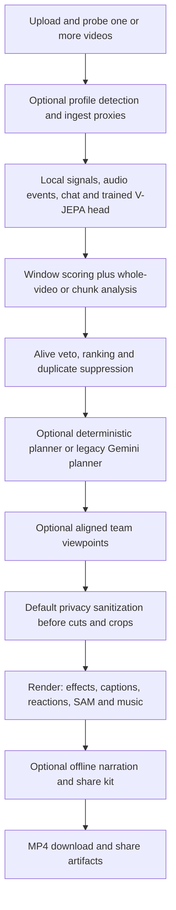

# Integrated Extension pipeline

The durable Flask queue calls `pipeline.Pipeline`. All options below are accepted
by the analyze, plan and render JSON endpoints described in `docs/api.md`.
This document supersedes that document's old optional-module import table.



## Flags and defaults

Flags must be JSON booleans. Unknown fields are rejected.

| Option | Default | Integration |
| --- | --- | --- |
| `profiles` | false | Local game detection; per-game OCR regions, alive/dead rules and prompt fragments |
| `game` | auto | With profiles: auto, generic, valorant, overwatch2, deadlock, league_of_legends |
| `use_signals` | true | Scene, motion, audio-energy and optionally profile OCR candidates |
| `window_scoring` | true | Provider verifies local candidates; false retains local evidence |
| `audio_ai` | false | Offline audio event candidates enter the same scoring/veto/ranking path |
| `ingest` | false | Job-owned normalized video, low-resolution analysis proxy and overlapping 900-second chunks; timestamps offset back to source |
| `chat` | absent | With ingest: numerical replay bins, described below |
| `vjepa` | false | Contributes only when `VJEPA_HEAD` names an existing trained head; missing extras/head contribute no scores |
| `planner` | false | Deterministic narrative planning; unavailable, incompatible or empty plans fall back to the existing Gemini planner |
| `fx` | false | The effect catalog selects timed zoom punches in deterministic plans; renderer composes validated timed registry requests |
| `privacy` | **true** | Detect and blur player-name regions on source media before edits, reframing or team composition |
| `privacy_options` | defaults | Privacy payload: game, OCR backend, own-name preservation, webcam, regions and manual timed boxes |
| `multipov` | false | Align repeated multipart video uploads by audio, rank viewpoints using local evidence, compose selected primary-timeline intervals |
| `team_mode` | best | best, split or pip; ambiguous synchronization warns and retains primary POV |
| `music` | false | Generate an offline energetic/chill bed when the plan has no user-supplied music; duck under gameplay audio |
| `narration` | false | Offline script and cached voiceover only; no automatic paid script/TTS calls |
| `social` | false | Offline share kit after rendering: video, metadata, chapters and thumbnails |
| `perf` | true | Encoder probing, bounded parallel clips, combined effects/SFX graph, SFX cache and compatible cut-only stream-copy joins |
| `captions` | false | Supplied word times or optional cached local transcription |
| `reactions` | true when REACTION_PACK exists | One seeded reaction selector per montage |
| `sam_reframe`, `sam` | false | Subject tracking and top-three spotlight freezes |
| `preset` | landscape | landscape, vertical or square; API defaults to 1080 short-side resolution |
| `generate_thumbnails` | false | Legacy route retains true; may make paid thumbnail requests |

All previously supported mode, style, prompt, splits, max_duration and explicit
edit_plan inputs remain available. An explicit plan skips provider calls.
Optional integrations are lazy imports. Missing imports produce snapshot warnings;
installed render failures remain sanitized stage errors, not silently successful
jobs. Privacy OCR failure uses the module's conservative whole-region fallback.
For unknown games, privacy uses common HUD regions instead of guessing a game.
The user must review privacy output: OCR and region coverage are not guarantees.

Analysis flags invalidate analysis and downstream checkpoints. Planner/fx/style
changes invalidate planning and rendering. Other render flags invalidate only
rendering. Sources, proxies and internal filesystem paths are excluded from public
snapshots. Evidence and stage timings are JSON serializable and survive restart.

## Evidence, timing and rendering

Analysis adds audio events, numerical chat spikes and trained-head V-JEPA scores to
local candidates before provider verification. At most 30 strongest candidates are
scored. A non-alive or unknown viewpoint veto suppresses overlapping candidates
from both local and whole-video analysis. Alive neutral windows are omitted.
Ranking uses 0.35 * local score + 0.65 * hype / 10 for verified windows, followed by
nonmaximum suppression at half the shorter interval. Unscored local scores are
normalized monotonically as `0.5 + atan(raw_score) / pi` to (0, 1); provenance is recorded as `atan_signal`. The UI converts unit scores to percent. Whole-video results retain their score or default to 0.5.

Profiles contribute both the whole-video prompt and the provider's window prompt.
Ingest changes analysis media only; rendering retains original-quality media.
Chunk results are offset before fusion, and cached chunks are never deleted as
legacy split scratch files. `splits` is superseded when ingest supplies chunks.

The planner v2 output and renderer v2 input meet at
`planner.adapter.to_render_plan` (adapter version 1). Shared style/aspect names
live in `render.contracts`. The adapter validates the native version, rejects
empty plans, and subtracts each clip's output start from all placements. Speed
is applied once by the renderer; captions, reactions, effects, transitions and
SFX already use output seconds and are not divided by speed again. Native plans
remain available in `planner_plan`. Music mood/energy are intent, not an asset;
licensed/generated music must still be supplied separately.

Legacy preparation retains titles and retimes words, subject tracks and timed FX
by the measured encoded/source duration ratio, including unchanged segments in
a mixed plan. Native v2 plans retain top-level music, cards, fps and transitions.
SAM spotlight freezes can extend the planned duration.

React sends current caption/reaction/SAM flags and style at export. Editable
clip text is a title (`title`), not a transcript. Planning settings are persisted
separately; a changed/unknown style submits no stale explicit plan, allowing the
queue to replan from saved reviewed clips. Provider credentials must be configured
on the backend for the React UI; it has no key-entry control.

`services.provider_config` owns provider IDs and secret-free configuration
reporting. `gemini` uses GEMINI_API_KEY by default; set
GOOGLE_GENAI_USE_VERTEXAI=true and GOOGLE_API_KEY for Vertex express. An explicit
request key overrides the environment key in the selected mode. `local` and
`local_vlm` are hybrid: local analysis with Gemini planning unless `planner=true`.
Unknown provider IDs raise without constructing a paid client.

Scope limitation: `server/api.py` still needs to use `configuration()` for
`/api/info`, and `server/validation.py` needs `validate_provider()` for synchronous
HTTP rejection. Those files belong to the server worker. Pipeline rejection is
already enforced; the old info endpoint can still report a GOOGLE-only setup as
unconfigured. The HTTP plan-admission/security work is likewise separate.

`perf:false` or `LIM_PERF=0` selects the comparison renderer. Source-time trimming
is now the perf default, matching the corrected legacy renderer. Explicit
`Clip(timing="legacy")` remains available to toolkit callers. Encoder selection
probes actual hardware operation and retries CPU after hardware encode failure.
VAAPI graphs currently use CPU in v2 because ASS/RGB filters require host frames.
Parallel work preserves segment order; reaction/SAM callbacks remain sequential
because their selectors and progress records are stateful. Supplied captions,
VFX and SFX share a clip encode. Automatic transcription needs a rendered audio
pass first. SFX cache entries live in disposable render scratch; they are shared
between clips in the same render. Privacy and team preprocessing are separate
passes, so the speedup depends on enabled features. Legacy source-size and
thumbnail routes retain their compatibility renderer and its existing limits;
use the new job render endpoint for v2 framing, music and timed FX.

Narration does not initiate network synthesis; missing cached voiceovers leave
script-only output and warnings. Generated music beds are at most 600 seconds and
loop for longer montages. An existing plan music track always wins. Share-kit
creation receives the final montage and never an unsanitized source thumbnail.
Share artifacts live within the job directory and are removed by job deletion.
V-JEPA requires the optional dependencies and encoder weights corresponding to
the trained head; model loading follows that module's configuration.

## Try it

Start `cd full_app && python app.py`. POST a multipart `video` to `/api/jobs`.
Repeat that field (up to eight files) for a team job. Upload filenames are not
used as paths or player labels. Then POST to `/api/jobs/<id>/analyze`:

```json
{"profiles":true,"game":"auto","audio_ai":true,"ingest":true,"planner":true,"fx":true,"max_duration":30}
```

POST to `/api/jobs/<id>/render`:

```json
{"preset":"vertical","music":true,"social":true,"perf":true}
```

Privacy is already enabled. Enable team mode with `multipov:true` and optionally
`team_mode:"split"`. For numerical Twitch replay evidence, add `chat` with bins
like `{"time":12,"activity":3,"emotes":2,"clip_it":1}` to analysis. Raw chat
text/usernames are rejected rather than persisted. This API does not download
Twitch URLs; upload owned recordings and preprocessed replay counts.

Observe `/api/jobs/<id>/events`, download `/api/jobs/<id>/download`, and retrieve
share artifacts from `/api/jobs/<id>/share/metadata.json` or `/share/video.mp4`.
Keys stay in environment/request memory. No live API calls are needed for tests.

## Offline demo and verification

The old EXT-16 driver imports removed in-memory `app.jobs`, `WORKSPACE` and client
hooks. Its maintained adapter is now `pipeline.demo`, inside the task's allowed
paths. It uses the same original procedural video generator as
`full_app/demo/run_demo.sh`, but uses isolated durable Flask jobs, the current
planner/render/reaction/social contracts and audio candidates. The old shell
launcher itself remains outside this task's edit scope; invoke the adapted driver:

```bash
tools/remote_run.sh "cd full_app && python -m pipeline.demo --output /tmp/int02-demo --duration 150 --budget 12"
tools/remote_run.sh "cd full_app && python -m pytest -q -m 'not live'"
```

The demo blocks networking and uses oracle model scores. It tests media and API
integration, not model accuracy. It exercises the native planner, then retains
complete event cuts for the barcode coverage oracle. Dedicated integration tests
separately render the unmodified native planner output. The e2e tests decode every
output frame and check the top events in encoded pixels in both aspect ratios.

INT-02 Linux baseline: **597 passed, 8 failed, 14 skipped, 1 deselected, 2 errors**,
289.63 seconds, exit 1. **Final: 627 passed, 14 skipped, 1 deselected; exit 0**.
Verification and comparison timings follow below.


### Measured perf comparison

Both runs used the adapted 150-second original demo fixture, a 12-second edit
budget, separate cold ingest caches, no network and the same committed renderer.
Each emitted a landscape and vertical montage containing the top two events.
The oracle demo disables privacy to preserve its pixel barcodes and uses mocked
model responses; native-planner/privacy/team combinations have separate tests.
This is one before/after pair on the shared Linux runner, not a statistical claim.

| Measurement | LIM_PERF=0 | LIM_PERF=1 |
| --- | ---: | ---: |
| End to end | 64.608 s | 56.058 s |
| Landscape v2 render | 4.5983 s | 2.0047 s |
| Vertical v2 render | 4.9934 s | 1.6766 s |
| Combined v2 render | 9.5917 s | 3.6813 s |
| Encoded duration, each preset | 7.500 s | 7.521 s |
| Live calls | 0 | 0 |

End-to-end time decreased 13.2%; v2 render time decreased 61.6%. The 21 ms
container-duration difference is AAC/concatenation rounding, within the media
regressions' tolerances. Reports remain on the runner at
`/tmp/int02-perf-before/report.json` and `/tmp/int02-perf-after/report.json`.
No generated videos or model files are committed.

Commands below omit stdout/stderr log redirection; both completed with exit 0:

```bash
tools/remote_run.sh "cd full_app && LIM_PERF=0 python -m pipeline.demo --output /tmp/int02-perf-before --duration 150 --budget 12 && LIM_PERF=1 python -m pipeline.demo --output /tmp/int02-perf-after --duration 150 --budget 12"
```

### Validation history

All pytest commands were sent through `tools/remote_run.sh`, from the worktree
root, with `cd full_app &&` preceding the command shown. No live calls were made.

| Command | Result | Exit |
| --- | --- | ---: |
| `python -m pytest -q -m 'not live'` (baseline) | 597 passed, 8 failed, 14 skipped, 1 deselected, 2 errors | 1 |
| `python -m pytest -q tests/e2e tests/test_perf.py tests/test_capture.py tests/test_jobs.py` | 93 passed, 1 skipped, 2 demo errors | 1 |
| `python -m pytest -q tests/test_int02.py tests/e2e tests/test_pipeline.py` | 55 passed, 2 demo errors | 1 |
| `python -m pytest -q tests/e2e tests/test_int02.py` | 35 passed, 2 demo errors | 1 |
| `python -m pytest -q -m 'not live'` (first integrated full run) | 624 passed, 1 old encoder-mock failure, 14 skipped, 1 deselected | 1 |
| `python -m pytest -q tests/test_int02.py tests/e2e tests/test_render_v2.py` | 65 passed in 76.71 s | 0 |
| `python -m pytest -q -m 'not live'` (verified final retry) | **627 passed, 14 skipped, 1 deselected in 347.77 s** | **0** |
| `python -m pytest -q -m 'not live'` (green log; SSH reset) | 627 passed, 14 skipped, 1 deselected in 351.07 s | 255 (SSH transport) |

Two early pytest invocation errors (shell quoting and the nonexistent
`tests/test_render.py` path) returned pytest exit 4 without executing tests;
subsequent commands above corrected them. Local `python -m compileall -q` on
the changed packages and `git diff --check` also returned exit 0.

### Files and handoff

- `pipeline/orchestrator.py`, `extensions.py`, `ranking.py`, `rendering.py`: module
  adapters, fusion, planner translation, render preparation and postprocessing.
- `pipeline/demo.py`: durable-API adaptation of the existing offline demo.
- `server/api.py`, `validation.py`, `queue.py`: flags, repeated multipart uploads,
  artifact download, checkpoint invalidation and interrupted-scratch cleanup.
- `render/__init__.py`, `engine.py`, `plan.py`: public local adapter, timed FX,
  bounded parallel rendering, combined captions/SFX and stream-copy joins.
- `services/ffmpeg_runner.py`, `video_understanding.py`, `perf/graph.py`: actual
  renderer perf integration, profile window prompts and corrected trim semantics.
- `tests/test_int02.py`, `test_jobs.py`, `test_capture.py`, `test_render_v2.py`,
  `tests/e2e/test_e2e_pipeline.py`: new integration and updated regression coverage.
- `docs/pipeline.md`: options, limitations, commands, timings and verification.

Integrator follow-up outside this task's allowed paths: change the old
`full_app/demo/run_demo.sh` entry point from `python -m demo.pipeline` to
`python -m pipeline.demo`, and fold this document's options into `docs/api.md`.
The replacement CLI and HTTP options are already usable without those edits.


The 351.07-second run's pytest log was green, but SSH reset before the runner
returned its exit status. The verification retry streams output through `tee`
and persists the actual pytest exit status in `/tmp/int02-verified.rc`; it does
not infer a successful wrapper exit from the test summary alone.

The verification retry completed with **627 passed, 14 skipped, 1 deselected in
347.77 seconds**. Both the `tools/remote_run.sh` process and the saved pytest exit
code were **0**. Scope audit: all 20 changed files are within INT-02's allowed
paths; no live calls, pushes or merges occurred.
